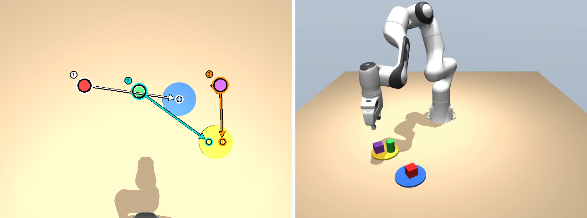

# 言葉で頼めるお片付けロボットアーム

自然言語（日本語・英語）の指示（例：「全部片付けて。赤いのは青い皿、ほかは黄色い皿に」）を受けて、シミュレータ上のロボットアームが机の上の物をつかみ、指定の皿へ運ぶ。指示の解釈は Claude（推論のみ）が、3次元位置への変換と動作はプログラムが受け持つ。



左：真上カメラの画像に、Claude が返した計画を重ねたもの（番号＝運ぶ順・太い輪＝つかむ点・十字の輪＝置く点）。右：実行後の正面の映像。

**結果**（28通りの指示 × 物の配置5通り）

- 日本語の指示で **140回中135回成功（96%）**。実行すべき指示は 110回すべて成功し、つかむ点の誤差は平均 0.22cm
- 存在しない物・曖昧な指示は、理由を添えて断る。失敗5件はすべて「ボールを青い皿へ」で、真上からは円柱が円に見えるため運んでしまったもの
- 英語の指示でも 135回成功し、同じ指示・配置の140組すべてで結果が一致。模倣学習（ACT）と同じ課題で比べると、本方式 20/20・ACT 13/20

- **シミュレータ**：MuJoCo（Franka Emika Panda ＋ 皿2枚・物3個）
- **指示の解釈**：Claude（推論のみ）に真上カメラ画像と指示文を渡し、対象物と置き先の画素座標を構造化出力で返させる（実行できない・曖昧な指示には理由を返させる）
- **動作**：ピンホールカメラモデルで画素を机上の3次元位置に変換し、逆運動学（減衰最小二乗 IK）で把持・運搬する
- **ROS 2 構成**：`sim`・`planner`・`tidy`・`evaluate` の4ノードに分割し、ROS 2 Humble 上で動作・評価する
- **模倣学習との比較**：同じ課題で ACT（Action Chunking with Transformers）を学習し、成功率と向き不向きを比較した
- **デモ動画**：https://youtu.be/uLbHxU5ccWQ
- **詳細レポート**：[`docs/report.md`](docs/report.md)

## 環境（ROS なし版）

- Python 3.13・[uv](https://docs.astral.sh/uv/)
- `uv sync`（ACT の学習・評価も動かす場合は `uv sync --group train`）
- Claude の API キーは環境変数 `ANTHROPIC_API_KEY`（または `.env`）で渡す（リポジトリに含めない）

```powershell
# 1つの指示を実行して画像・動画を書き出す
uv run python scripts/run_instruction.py "赤い箱を青い皿に置いて" --planner claude --video

# 28通りの指示 × 5配置の評価（ROS なし版）
uv run python scripts/evaluate.py --planner claude --seeds 5

# テスト
uv run pytest
```

## ROS 2 版（Docker / ROS 2 Humble）

講義と同じ Docker イメージ（`airobotbook/ros2-desktop-ai-robot-book-humble`）上で動かす。詳しい手順は [`ros2/README.md`](ros2/README.md) を参照。

```powershell
# コンテナ起動・環境構築・ビルド
.\ros2\run_container.ps1
docker exec pai_final bash /workspace/ros2/setup_container.sh
docker exec pai_final bash /workspace/ros2/build.sh

# 28指示 × 5配置 × 日英の評価を ROS 2 経由で回す
docker exec pai_final bash /workspace/ros2/run_eval.sh --seeds 5 --lang ja en
uv run python scripts/compare_lang.py outputs/eval_ros2.csv
```

## 模倣学習（ACT）との比較

```powershell
# 手本データ（200本）の収集
uv run python scripts/collect_demos.py --episodes 200 --out outputs/demos.npz

# 学習（Colab 用のノートブックは notebooks/train_act_colab.ipynb）
uv run python -m tidy_arm.act --data outputs/demos.npz --out outputs/ckpt --steps 20000

# 評価（20配置）
uv run python scripts/eval_act.py --policy act --ckpt outputs/ckpt/final.pt --seeds 20
```

## 提出用動画の生成

```powershell
uv run python scripts/record_scenes.py --planner claude
uv run python scripts/make_video.py --repo-url https://github.com/physai-learner/comp-matsuo-pai-final-2026
```

## 使用したOSS・素材

- [MuJoCo](https://github.com/google-deepmind/mujoco)（Apache-2.0）
- [MuJoCo Menagerie](https://github.com/google-deepmind/mujoco_menagerie) の Franka Emika Panda モデル（Apache-2.0）
- [Anthropic Python SDK](https://github.com/anthropics/anthropic-sdk-python)（MIT）
- [ROS 2 Humble](https://docs.ros.org/en/humble/)（Apache-2.0）・講義用 Docker イメージ `airobotbook/ros2-desktop-ai-robot-book-humble`
- [PyTorch](https://pytorch.org/)（BSD-3-Clause）・[torchvision](https://github.com/pytorch/vision)（BSD-3-Clause、ResNet18 の学習済み重みを使用）
- ACT の手法：T. Z. Zhao et al., "Learning Fine-Grained Bimanual Manipulation with Low-Cost Hardware," RSS 2023（実装は自作）
